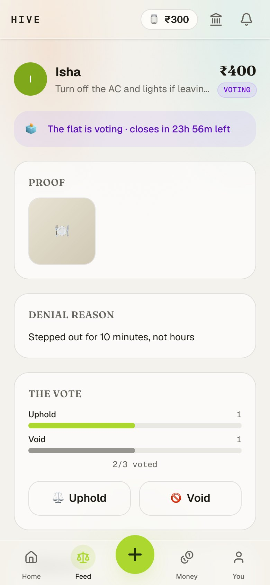
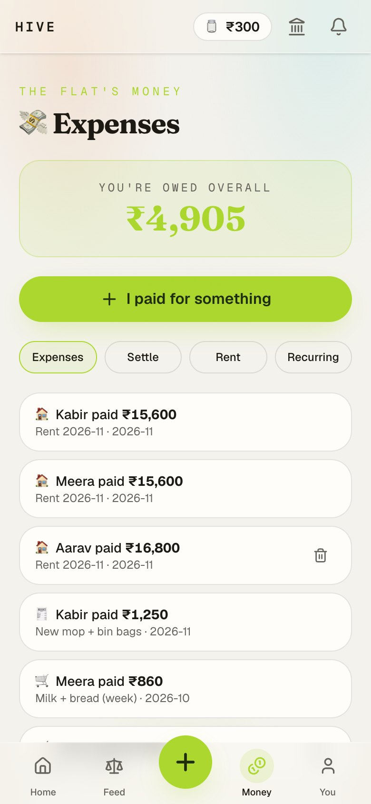
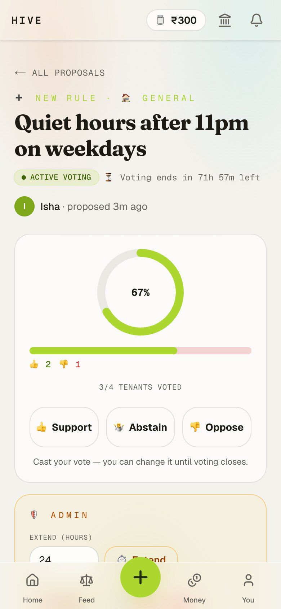
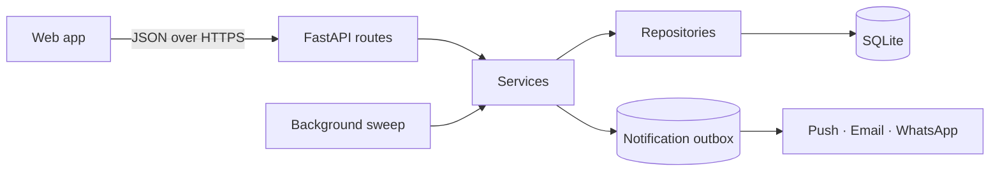

<div align="center">

# Hive API

**The backend for Hive: an app that runs a shared flat.**

House rules, fines backed by photo proof, flat votes on disputes, shared expenses,
rent and settle-up.


[Web app](https://github.com/vijayfagaria-dev/hive-web) · [Features](#features) · [Architecture](#architecture) · [Getting started](#getting-started)

</div>

<br>

| Disputed fine under a flat vote | Shared expenses | Rule change proposal |
|---|---|---|
|  |  |  |

## About

Shared flats run on informal agreements: who owes what, whose turn it was, which rule got
broken. Hive makes those agreements visible and fair. Fines need evidence, disputes are
settled by the flat, every rupee is accounted for, and the rules change only by vote.

This repository is the API. The web client lives in
[hive-web](https://github.com/vijayfagaria-dev/hive-web).

## Features

- **Complaints with evidence:** report a rule break with a photo; the accused accepts or
  disputes, and disputes go to a time-boxed flat vote.
- **Shared expenses:** six split strategies, rent split by tenant share, recurring expenses
  and partial payments.
- **Settle-up:** clears the whole flat in at most *n − 1* transfers, with UPI payment links.
- **Governance:** propose, discuss and vote on rule changes, merged into a versioned rule
  book with rollback.
- **Household management:** tenant and guest roles, invite links and member management.
- **Notifications:** in-app, Web Push, Firebase, email and WhatsApp.
- **Accounts:** email-verified sign-up, password reset by one-time code, and session control.

## Architecture



A layered service: thin routes, business rules in services, and queries in repositories,
with one transaction per request. Time-based work (closing votes, auto-confirming
complaints, recurring expenses) runs in an in-process sweep, and notifications are
delivered from an outbox so that slow providers never block a request.

## Getting started

Requires Python 3.11+.

```bash
git clone https://github.com/vijayfagaria-dev/hive-api.git
cd hive-api
python3 -m venv .venv && .venv/bin/pip install -r requirements.txt
.venv/bin/uvicorn app.main:app --reload
```

The API runs at `http://localhost:8000`, with interactive docs at `/docs`. A fresh database
is created and seeded on first start.

## Tech stack

FastAPI · Pydantic · SQLAlchemy 2.0 (async) · SQLite · Alembic · bcrypt · uvicorn · Caddy ·
deployed on Oracle Cloud.
